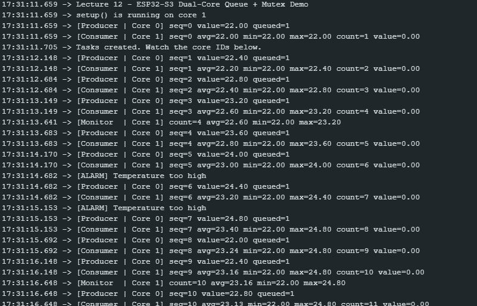

# ESP32-S3 Dual-Core Producer-Consumer Data Pipeline

**Purpose:** Demonstrate FreeRTOS core affinity, inter-task communication using a queue, and mutex-protected shared statistics across both cores of an ESP32-S3.

**Board Setup & Tools:** ESP32-S3 DevKitC-1, Arduino IDE 2.x. No external sensors or wiring required (uses simulated sensor data). Serial Monitor set to 115200 baud.

---

## 1. Application Architecture

Simulated temperature sensor data is created by the producer task on core 0 every 500ms encapsulated in a sensorData struct. This struct is sent to a queue to be read by the consumer task which then takes a mutex and takes a snapshot of the data and releases the mutex on the statistics data. the monitor task in the loop will then use this statistics data and take it's own snapshot every 3 seconds. there is a high priority alarm task which is activated by a semaphore conditional in the consumer task  which runs whenever temperature exceeds 24 degrees. 

```text
[Producer Task (Core 0)] ---> [FreeRTOS Queue] ---> [Consumer Task (Core 1)]
                                                            |
                                                 (Mutex-Protected Struct)
                                                            |
                                                   [Monitor in loop()]
```

### Component Responsibilities
* **Producer Task (`Core 0`):** [Explain what the Producer generates, how it structures each reading with a sequence number, and how it sends it to the queue.]
* **Consumer Task (`Core 1`):** [Explain how the Consumer receives readings from the queue, processes them, and safely updates the shared statistics structure.]
* **Monitor (`loop()`):** [Explain how `loop()` periodically acquires the mutex, copies the shared statistics to local variables, releases the mutex immediately, and prints the summary to the Serial Monitor.]

---

## 2. Synchronization & Design Choices

* **Why Producer and Consumer use different cores:** This splits the responsibilities cleanly and allows for parallel workloads that work synergetically. 
* **Why a queue is used:** A queue is used because it is an easy and simple way to transfer data across cores without having to worry about race conditions and handles simple effective buffering 
* **Why the shared statistics require a mutex:** This is a resource used by more than one task so it is a race condition and subject to being misread at the same time as another task is writing to it requiring a mutex. Although in this specific code the loop task is lower priority so it should not actually be a problem. 

---

## 3. Changes & Required Extension

**Changes from the Lecture Demonstration (`481405643761155073`):**
I added a semaphore and an alarm task to alert when temperature exceeds a threshold.
**Implemented Extension:**
* **Extension Chosen:** Temperature Alert
* **How It Works:** Consumer task evaluates temperature from readings before any calculations ensuring low latency and if it exceeds the threshold it will flag the alarm task making the alarm run. I chose to put it in the consumer and core 1 to keep data processing methods together and as the consumer task used does not have a high risk of missing reads from the queue it works nicely. A more robust method for a real critical alarm would be to use a hardware interrupt from a comparator circuit or another method. 

---

## 5. Serial Monitor Output & Observations



**What Can Be Seen in the Screenshot:**
We can see the different tasks logs.

---

## AI Usage
* **Tool used:** Gemini
* **How I used it:** used to structure readme 