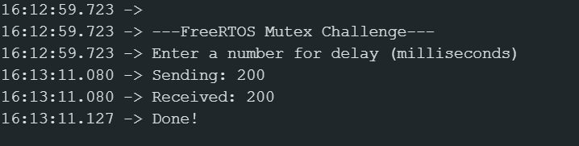

# FreeRTOS Mutex Synchronization Challenge

**Purpose**
This assignment demonstrates using a mutex to prevent the `setup()` function from finishing before a newly created task (`blinkLED`) copies its parameter, avoiding a race condition with a local variable.

## Screenshot

## Questions

**1. Why can passing the address of a local variable to a task be unsafe?**
> *Local variables are destroyed at the end of a function, for example without the mutex in the code the setup function would complete it's run and lose the delay_arg variable before it can be passed to the led blink task parameter. When the led task tries to read the parameter address it reads some garbage data that becasue the address has been emptied.* 
**2. When does blinkLED copy the parameter?**
> *The blinkled task copys the parameter after setup creates the task and the setup task delays allowing for the led task to take control of the CPU and complete the write before handing the mutex back to the setup function.*

**3. How does the mutex make setup() wait?**
> *The setup function can't do anything until it can take the mutex from led task after it has been given.*

**4. Why is this described as a demonstration hack? What would be a better design in a real application?**
> *Using a queue would be a better approach to this problem, this would simplify the architecture.*>

## AI Usage
- **Tool used:** Gemini
- **How I used it:** I used it to format my readme
