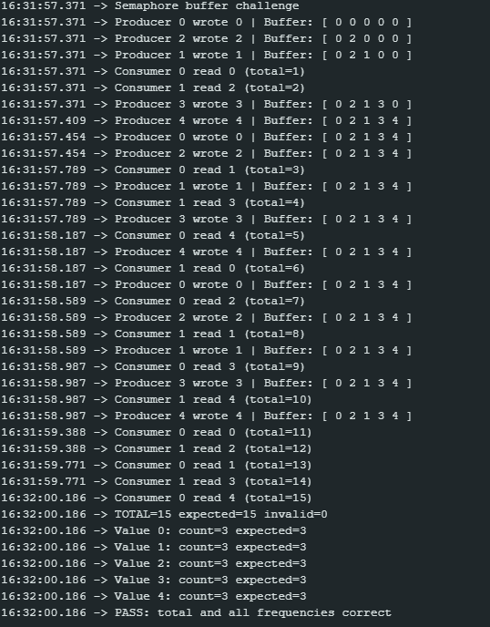

# FreeRTOS Semaphore Buffer Assignment

## 1. Serial Monitor Log

## 2. Assignment Questions

**1. What does `emptySlots` count?**
It counts the number of available spaces in the circular buffer. It starts at the maximum capacity: 5 and signals how many more times producers can write before they have to wait.

**2. What does `filledSlots` count?**
It counts the number of occupied slots in the circular buffer. It starts at 0 and signals how many times consumers can read before they are forced to wait for new data.

**3. What does the mutex protect?**
The mutex protects the shared `buffer` array and the `head`/`tail` index variables. By enforcing one task owner at a time, taking a mutex prevents race conditions where a producer and a consumer might try to modify the array at the exact same microsecond.

**4. What did you change in the second test, and what happened?**
I increased the `CONSUMER_DELAY_MS` variable to slow down the consumer tasks, leaving the delay outside the mutex-protected section. Because the producers worked faster than the consumers, the buffer filled up. Once all 5 slots were full, the `emptySlots` semaphore count hit zero and the producers were forced into the Blocked state. Execution slowed to the rate of the consumers, but no data was lost, and all 15 values were still successfully transferred.

## 3. AI Assistance
- **Tool used:** Gemini
- **How I used it:** I used Gemini to clarify how the scheduler handles equal-priority tasks and for formatting the README.md