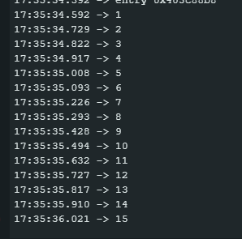
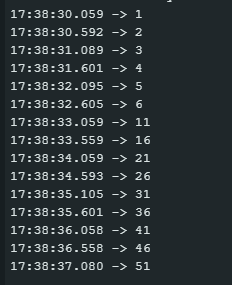

# ESP32-S3 ISR to FreeRTOS Queue

**Purpose:** Transfer hardware timer events from an ISR to a task via a queue and observe behavior.

**Board Setup & Wiring:** ESP32-S3 DevKitC. No external wiring required. Serial monitor set to 115200 baud

## Run A: 20 ms Task Delay

**Output Excerpt:**

**Observation:** 
The task processes items (20 ms) faster than the hardware timer generates them (100 ms). The 4-slot queue never fills, no interrupts are dropped, and the sequence numbers print continuously without gaps.

## Run B: 500 ms Task Delay

**Prediction:**
If the task processes items 400ms slower than the ISR generates then some data will be lost while the consumer task is blocked from the delay. The task would be undersampling the Queue.
**Output Excerpt:**

**Explanation of Queue Capacity and Gaps:**

The queue capacity is 4 slots. This allows for safe transfers without too much RAM. 

**Timeline of events:**

- **0 ms:** When the system first wakes up, the consumer task is ready and waiting for a queue reception.
- **100 ms:** The interrupt triggers, writes `1`, and the consumer takes it and prints it.
- **100–500 ms:** The consumer is then blocked for 500 ms. This allows the queue to fill up the 4 slots:
  - 200 ms -> `2`
  - 300 ms -> `3`
  - 400 ms -> `4`
  - 500 ms -> `5`
- **600 ms:** The consumer takes `2` from the queue, freeing a space. This allows the ISR to write a `6` into the queue at 600 ms.
- **700–1000 ms:** After this, however, the queue is now full and has to drop incoming values (7, 8, 9, 10 — skipping 10 too, because the ISR has to write the value first before sending the queue).
- **Next cycle:** The consumer runs and prints `3`, opening a slot in the queue which will be filled by the current counter value: `11`.

**Conclusion:** This is why there is a 5 value gap. Technically the value is still accurate, but data resolution and timing are not.

## AI Usage
- **Tool used:** Gemini
- **How I used it:** I used it to format the readme and generate queue code
